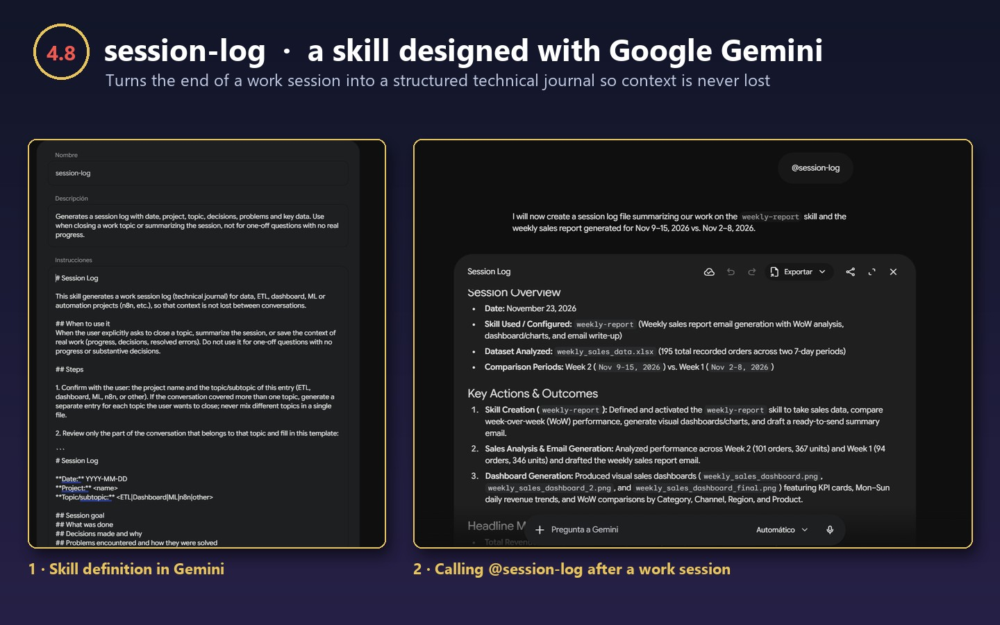

# Extra Credit Challenge 4.8: `session-log`

*A useful skill designed with Google Gemini. Alejandro Meyer Contreras, New Frontiers of AI, Unit 4.*



## What it is used for

I work on data projects: ETL pipelines, dashboards, ML experiments and automations in n8n. These projects run across many chat sessions. Every new conversation starts from zero, and decisions, fixes and dead ends from earlier sessions get lost. I end up explaining the same context again, or repeating an approach that already failed.

**`session-log` turns the end of a work session into a structured technical journal entry.** When I close a topic, I call `@session-log` and Gemini writes a dated Markdown file with:

- the goal of the session
- what was done
- the decisions made and why
- the problems I hit and how they were solved
- what I tried that did not work
- the relevant data and artifacts
- the next steps

Over time these entries become a project history. I can paste them into a new conversation, so the assistant knows where we left off.

**Why it is useful:**

- **No lost context:** the next session starts from the log instead of from memory.
- **Honest records:** sections with no real content are marked "N/A" instead of being filled with generic text.
- **One topic per file:** different subjects (for example ETL and a dashboard) never get mixed, so each file stays easy to find.
- **Consistent file names:** `YYYY-MM-DD_<project>_<subtopic>.md` sorts the files by date and project.
- **Project memory stays current:** when a session changes the overall state of the project, the skill proposes a targeted edit to `MEMORY.md`. It edits only the section that changed and does not append at the end.

**Example (right side of the image):** after building the `weekly-report` skill, I called `@session-log`. Gemini produced a log of that session covering:

- the dataset: 195 orders over two weeks, Nov 9–15 vs Nov 2–8, 2026
- the key actions: skill creation, WoW analysis, email draft
- the generated dashboards
- the headline metrics

---

## The skill

**Name:** `session-log`

**Description:** Generates a session log with date, project, topic, decisions, problems and key data. Use when closing a work topic or summarizing the session, not for one-off questions with no real progress.

### Instructions

> **Session Log**
>
> This skill generates a work session log (technical journal) for data, ETL, dashboard, ML or automation projects (n8n, etc.), so that context is not lost between conversations.

#### When to use it

When the user explicitly asks to close a topic, summarize the session, or save the context of real work (progress, decisions, resolved errors). Do not use it for one-off questions with no progress or substantive decisions.

#### Steps

1. Confirm with the user the project name and the topic/subtopic of this entry (ETL, dashboard, ML, n8n, or other). If the conversation covered more than one topic, generate a separate entry for each topic the user wants to close. Never mix different topics in a single file.

2. Review only the part of the conversation that belongs to that topic and fill in this template:

   ```markdown
   # Session Log

   **Date:** YYYY-MM-DD
   **Project:** <name>
   **Topic/subtopic:** <ETL|Dashboard|ML|n8n|other>

   ## Session goal
   ## What was done
   ## Decisions made and why
   ## Problems encountered and how they were solved
   ## What was tried and did not work
   ## Relevant data and artifacts
   ## Next steps
   ## Loose notes
   ```

   Do not invent content for sections with no real information in the conversation. If a section does not apply, write "N/A" instead of filling it with generic statements.

3. Name the file `YYYY-MM-DD_<project>_<subtopic>.md` (all lowercase, underscores, no spaces).

4. Ask whether anything from this session changes the overall state of the project, such as a substantive decision or a resolved pending item. If the user confirms it does, propose the matching targeted edit to their `MEMORY.md` file. Do not append at the end: edit the specific section that changed. Do not assume this step always applies.

5. Deliver the generated file to the user for download. Do not assume a destination folder. If the user is in Claude Code (terminal) and provides a path, write the file directly there instead of only delivering it.

---

[← Back to Unit 4](../unit.html?unit=4)
